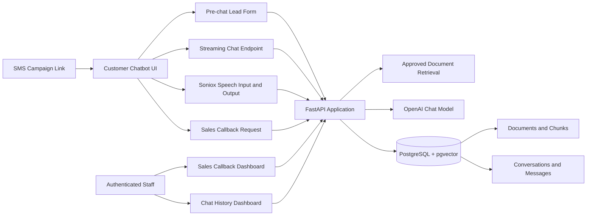

# JorMall Interactive SMS Chatbot

## Overview

JorMall Interactive SMS Chatbot is a FastAPI application for turning an SMS campaign link into a client-specific chatbot experience. A customer receives an SMS, opens the chatbot link under the `/interactive-sms/` public prefix, enters required contact details, and then asks questions in a responsive web chat interface.

The application streams chatbot responses from the backend, stores customer and assistant messages in PostgreSQL, and keeps a visible browser-session conversation history in `sessionStorage` so the current chat can be restored after a page refresh in the same browser session. Authorised staff can review persistent conversations in the protected chat-history dashboard. Customers can also request a sales callback, and authorised staff can review and update callback requests from a protected sales dashboard.

Persistent storage depends on the configured PostgreSQL database and Docker volumes. No real conversation records, callback records, mobile numbers, or secrets are included in this repository.

## Features

- Client-specific chatbot page for the exported `central-e-commerce-co-ltd` client.
- Public chatbot served under `/interactive-sms/`.
- Client identification through the configured client slug.
- SMS campaign flow where a public link opens the chatbot.
- Pre-chat customer information gate with customer name and Jordanian mobile-number validation.
- Arabic and English frontend labels, starter questions, and response rendering.
- Arabic and English push-to-talk voice mode with server-side Soniox credentials.
- Low-latency Soniox `stt-rt-v5`/`tts-rt-v2` speech, with confidence-based
  `stt-async-v5` verification and Soniox REST transport fallback.
- Voice questions use the same approved retrieval, GPT answer generation,
  lead session, conversation history, safety controls, and page language as text chat.
- Client branding through configured assets and Jinja templates.
- Responsive vanilla JavaScript chat frontend.
- Starter questions, including a sales callback starter action.
- Streaming chat responses through `/interactive-sms/api/chat/{client_slug}/stream`.
- Source-grounded answer generation using approved document chunks.
- Deterministic handling for selected business, greeting, pricing, contact, and callback intents.
- Browser-session visible conversation restoration using `sessionStorage`.
- Persistent PostgreSQL chat history for conversations and messages.
- Protected chat-history dashboard at `/interactive-sms/chat-history/`.
- Chat-history search, conversation detail view, status/follow-up/assignment fields, notes, archive/restore actions, and CSV export.
- Sales callback request workflow with duplicate pending-request protection.
- Protected sales callback dashboard at `/interactive-sms/sales-callbacks/`.
- Dashboard authentication using signed HttpOnly cookies, CSRF protection, failed-login throttling, and logout.
- PostgreSQL persistence with pgvector support.
- Idempotent startup database creation and lightweight migrations.
- Docker Compose deployment with `chatbot` and `postgres` services.
- Reverse-proxy/base-path support through `APP_BASE_PATH=/interactive-sms`.
- Health endpoints: `/health` and `/db-health`.
- Logging and graceful error handling for stream and persistence failures.

## Persistent Chat History

Persistent chat history is implemented with SQLAlchemy models in `app/models/document.py` and helper functions in `app/services/conversation_store.py`.

The main tables are:

- `chat_conversations`
- `chat_conversation_messages`

`ChatConversation` stores one persistent conversation per `(client_slug, public_session_id)` pair. It also stores the lead-session id, lead id when available, campaign name, chatbot name, customer name, customer mobile number, language, source, status, assignment, follow-up flag, internal notes, start time, last activity time, completion time, and timestamps.

`ChatConversationMessage` stores individual messages linked to a conversation by `conversation_id`. Each message has a role (`user`, `assistant`, or `system`), content, optional metadata, model/response ids, an error state, and a creation timestamp.

The public chat flow works as follows:

1. The browser creates or reuses a local chat session id.
2. The lead form posts customer details to `/interactive-sms/api/chat/{client_slug}/lead`.
3. The backend stores or updates the lead and ensures a matching `chat_conversations` row exists.
4. Each user message sent to the stream endpoint is saved through `save_customer_message`.
5. The final visible assistant answer is saved through `save_assistant_message`.
6. The browser also stores visible turns in `sessionStorage`, allowing the current visible chat to return after a page refresh in the same browser session.

The PostgreSQL database is the durable source for protected history. With the provided Docker Compose setup, PostgreSQL data persists in the `chatbot_db` Docker volume. The app also defines a `chatbot_conversations` volume mounted at `/app/data/conversations`, although the implemented conversation history is stored in PostgreSQL.

The protected chat-history dashboard includes:

- `GET /interactive-sms/chat-history/`
- `POST /interactive-sms/chat-history/login`
- `POST /interactive-sms/chat-history/logout`
- `GET /interactive-sms/api/admin/conversations`
- `POST /interactive-sms/api/admin/conversations/search`
- `GET /interactive-sms/api/admin/conversations/{conversation_id}`
- `PATCH /interactive-sms/api/admin/conversations/{conversation_id}/status`
- `PATCH /interactive-sms/api/admin/conversations/{conversation_id}/assignment`
- `PATCH /interactive-sms/api/admin/conversations/{conversation_id}/follow-up`
- `PATCH /interactive-sms/api/admin/conversations/{conversation_id}/notes`
- `POST /interactive-sms/api/admin/conversations/{conversation_id}/archive`
- `POST /interactive-sms/api/admin/conversations/{conversation_id}/restore`
- `GET` and `POST /interactive-sms/api/admin/conversations/export.csv`

The dashboard is protected by the same signed-cookie authentication utilities used by the sales dashboard. CSV export uses UTF-8 output and protects spreadsheet consumers from formula-injection values.

## Sales Callback Requests

Customers can request a sales callback from the chat interface. The frontend renders a callback confirmation panel when the assistant returns the callback marker or when the configured callback starter action is selected.

The public callback API route is:

```text
POST /interactive-sms/api/chat/{client_slug}/request-sales-call
```

The request payload includes the lead session id. Before accepting a callback request, the backend verifies that the pre-chat lead capture was completed for the client and session. Lead capture requires a valid customer name and a Jordanian mobile number matching `07XXXXXXXX`.

Callback requests are stored in the `sales_callback_requests` table and linked to `chatbot_leads` through `lead_id`. Each request stores the client slug, lead id, session id, status, request timestamp, contacted timestamp, and update timestamps. A partial unique index prevents more than one pending callback request for the same lead and client.

The customer receives a confirmation message stating that the sales team will contact them using the mobile number they provided. If a pending request already exists, the customer receives an already-received confirmation instead of creating a duplicate.

Authorised staff can review requests in:

```text
/interactive-sms/sales-callbacks/
```

The sales dashboard supports login/logout, listing requests, filtering by status/date/search, marking a request as contacted, and CSV export. Callback records are protected by signed HttpOnly session cookies, CSRF checks on state-changing routes, and failed-login throttling.

## Architecture

The application is a Python FastAPI service with Jinja templates, vanilla JavaScript, CSS, SQLAlchemy, PostgreSQL, pgvector, OpenAI API integration, and Docker Compose deployment.



## Main Routes

Public routes:

- `GET /interactive-sms/`
- `POST /interactive-sms/api/chat/{client_slug}/lead`
- `GET /interactive-sms/api/chat/{client_slug}/lead`
- `POST /interactive-sms/api/chat/{client_slug}/stream`
- `POST /interactive-sms/api/chat/{client_slug}/transcribe`
- `POST /interactive-sms/api/chat/{client_slug}/speak`
- `POST /interactive-sms/api/chat/{client_slug}/request-sales-call`

Protected dashboard routes:

- `GET /interactive-sms/sales-callbacks/`
- `GET /interactive-sms/chat-history/`
- `/interactive-sms/api/admin/...`

Health routes:

- `GET /health`
- `GET /db-health`

## Data Model Summary

Important SQLAlchemy models:

- `Document`
- `DocumentChunk`
- `ChatbotLead`
- `ChatbotLeadSession`
- `SalesCallbackRequest`
- `ChatConversation`
- `ChatConversationMessage`

`Document` and `DocumentChunk` store approved knowledge and vector embeddings. `ChatbotLead` and `ChatbotLeadSession` store pre-chat contact details and legal/notice state. `SalesCallbackRequest` stores callback workflow records. `ChatConversation` and `ChatConversationMessage` store persistent chat history.

## Configuration

Configuration is loaded from environment variables using Pydantic settings in `app/core/config.py`. See `.env.example` for required and optional values.

Important settings include:

- `DATABASE_URL`
- `OPENAI_API_KEY`
- `OPENAI_CHAT_MODEL`
- `OPENAI_EMBEDDING_MODEL`
- `SONIOX_API_KEY`
- `SONIOX_STT_MODEL=stt-rt-v5`
- `SONIOX_STT_FALLBACK_MODEL=stt-async-v5`
- `SONIOX_STT_MIN_CONFIDENCE=0.985`
- `SONIOX_TTS_MODEL=tts-rt-v2`
- `SONIOX_TTS_VOICE=Kayla`
- `APP_BASE_PATH=/interactive-sms`
- `PUBLIC_CHATBOT_BASE_URL`
- `ALLOWED_ORIGINS`
- `CALLBACK_DASHBOARD_PASSWORD`
- `CHAT_HISTORY_ENABLED`
- `ADMIN_SESSION_TIMEOUT`
- `CHAT_EXPORT_MAX_ROWS`
- `APP_TIMEZONE`
- `CHATBOT_SETUP_PRICE_JOD`
- `CHATBOT_ADDITIONAL_HOSTING_PRICE_JOD`

Do not commit a real `.env` file or production secrets.

## Docker Deployment

The project includes:

- `Dockerfile`
- `docker-compose.yml`
- `requirements.txt`
- `db/init/`

The Compose services are:

- `postgres`: `pgvector/pgvector:pg17`
- `chatbot`: FastAPI app served with Uvicorn

Typical local or server commands:

```bash
docker-compose config --services
docker-compose build chatbot
docker-compose up -d
docker-compose ps
docker-compose logs --tail=200 chatbot
```

The app listens inside the container on port `8000` and is published as `${APP_PORT:-3000}` by Docker Compose.

## Development and Verification

Run focused tests with:

```bash
python -m unittest tests.test_chat_history_helpers tests.test_pricing_and_fallbacks
```

Or inside Docker:

```bash
docker-compose run --rm chatbot python -m unittest tests.test_chat_history_helpers tests.test_pricing_and_fallbacks
```

Compile check:

```bash
python -m compileall app tests
```

Health checks:

```bash
curl -i http://127.0.0.1:3000/health
curl -i http://127.0.0.1:3000/db-health
```

## Security Notes

- The public chat only supports the configured target client slug in this exported package.
- The pre-chat lead form validates customer name and Jordanian mobile number.
- Dashboard sessions are signed and stored in HttpOnly cookies.
- State-changing dashboard routes require CSRF tokens.
- Failed dashboard logins are rate limited in memory.
- Real `.env` files, logs, caches, generated archives, browser artifacts, and local conversation files should not be committed.

## Repository Destination

This project is intended to be copied into the following repository path:

```text
projects/05-Interactive-sms-chatbot
```

The folder name must remain exactly:

```text
05-Interactive-sms-chatbot
```
